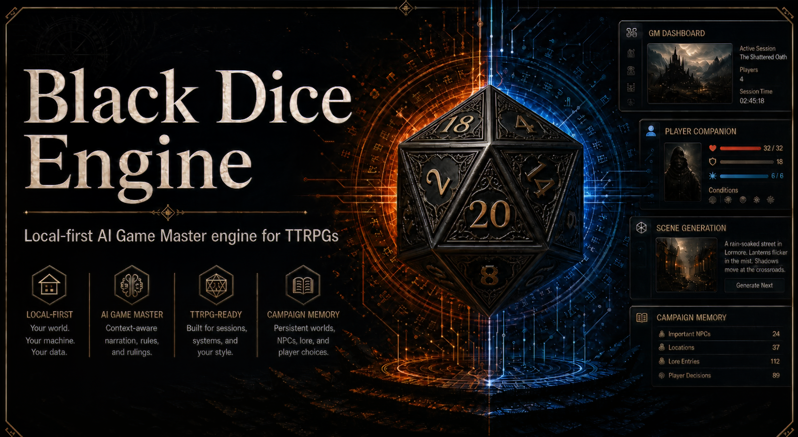
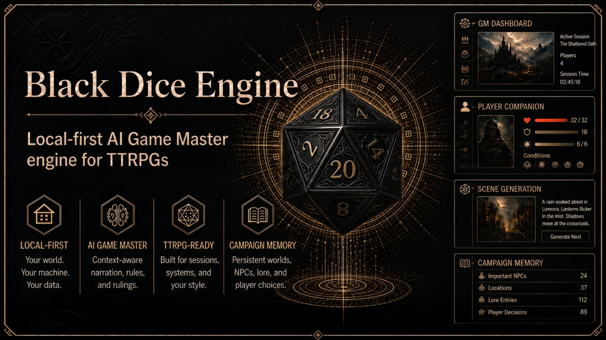

# Black Dice Engine

For the immediate party checklist, use [PARTY-PLAN.md](PARTY-PLAN.md). The larger [PLAN.md](PLAN.md) remains the deferred overhaul backlog.

For portable full-profile startup, see [full session launch](docs/full-session-launch.md). It preserves the configured/default database; use an explicit disposable data directory for demos. Python TTS is separately configured and launched; see [TTS setup](services/tts-service/README.md).

For phone character uploads, GM portrait approval and reference-conditioned campaign scenes, see [character artwork](docs/character-artwork.md).

Party Mode now has a [lightweight Windows launcher and host checklist](docs/party-launch.md): `start-party.bat` builds/serves host, TV and phone surfaces with optional AI/media/audio disabled. Physical phone/TV/Wi-Fi rehearsal is still pending. Track verified overhaul work in [PLAN.md](PLAN.md).

Local-first AI Game Master engine for dark, collaborative TTRPG campaigns.

  

Black Dice Engine turns a local gaming PC into an AI-powered tabletop RPG command center, combining live GM narration, player phone sheets, deterministic game-state tracking, campaign memory, and local scene generation.

  

## What It Is

Black Dice Engine is an experimental local-first toolset for running tabletop RPG campaigns with AI assistance. It is designed to keep the core campaign experience on the host machine while giving players lightweight companion views, shared character sheets, and structured state updates.

The goal is not to replace a human table. The goal is to help a GM or solo/group table keep pacing, continuity, atmosphere, rules state, and campaign memory under control.

## Problem It Solves

AI-assisted games can drift, forget details, invent contradictory state, or leak private material into remote services. Traditional virtual tabletop tools can also leave narration, memory, image generation, and rules bookkeeping split across many disconnected apps.

Black Dice Engine aims to make those pieces work together:

- The GM gets live narration support and deterministic state tools.
- Players get phone-friendly sheets and table state.
- The campaign gets structured memory instead of loose chat history.
- Local models and local media pipelines stay outside the repository.
- Generated content is routed through clear schemas and permissions.

## Local-First Architecture

This project is designed around a Windows gaming PC acting as the table host.

Planned local flow:

1. The GM dashboard sends table context, scene requests, and rules/state actions.
2. Game services validate dice, state events, character data, and campaign memory.
3. Local model adapters talk to tools such as Ollama, KoboldCPP, or other local inference runtimes.
4. The Comfy router sends approved scene/art prompts to a local ComfyUI instance.
5. Player companion clients connect over the local network for sheets, rolls, status, and limited scene updates.

Remote services should be optional and explicit. Secrets, private campaign data, paid PDFs, downloaded models, generated media, and personal notes should remain outside this repo.

## Main Features

Planned capabilities include:

- GM dashboard for live narration, scene control, and adjudication.
- Player companion app for phone/tablet character sheets.
- Deterministic dice and rules event service.
- Optional 3D dice presentation adapter, starting with free/default dddice visuals.
- Structured game-state service with auditable state events.
- Campaign memory service for canon, summaries, locations, factions, NPCs, and unresolved threads.
- Runtime health, reconnect, backup, and graceful-degradation design.
- ComfyUI routing layer for local image and video generation.
- Local audio cues for music moods, ambience loops, and one-shot stingers.
- Import service for user-owned notes and campaign material, with strict privacy boundaries.
- Shared JSON schemas for AI output and cross-service data.
- Prompt templates for GM narration, scene direction, memory canonization, and content rating.

## Planned Stack

The stack is intentionally not locked yet. Current likely direction:

- Windows-first local development.
- TypeScript for web apps and shared schemas.
- Next.js or Vite for the GM dashboard and player companion.
- Node.js or Python services where each makes sense.
- WebSockets for live table updates.
- SQLite for local structured state and memory indexes.
- Local LLM adapters for Ollama, KoboldCPP, or compatible endpoints.
- ComfyUI for local media generation workflows.
- Local tagged audio library for cached music, ambience, and stingers.
- JSON Schema for structured AI output contracts.

The initial workspace and first local prototype are now scaffolded. Dependency install is required before running the apps locally.

## What Is Intentionally Not Included

This repository should not contain:

- AI model files or downloaded checkpoints.
- Real campaign databases or private table notes.
- Generated images, generated videos, or ComfyUI outputs.
- Private PDFs, purchased adventures, rulebooks, or copyrighted campaign text.
- API keys, secrets, tokens, local credentials, or `.env` files.
- Large asset packs or personal media libraries.

Use local folders outside the repo for heavy/private material:

- `G:\AI-DM\02_models\`
- `G:\AI-DM\03_campaigns\`
- `G:\AI-DM\04_assets\`

## Safety And Legal Note

Only commit code, docs, schemas, prompts, config examples, and demo content that you have the right to share. Do not commit copyrighted adventure text, private campaign data, paid PDFs, extracted rulebooks, proprietary images, player personal data, secrets, or generated material that should remain private.

Sample content in this repo should remain original, generic, and SRD-safe/demo-safe.

## Project Status

Early prototype / experimental.

This repository now includes a first local prototype:

- a Node/TypeScript game server with health, runtime-status, session-snapshot, and dice-roll endpoints
- a small GM dashboard shell
- a small player companion shell

The local session boundary authenticates host/player/display capabilities and filters network payloads; see [local session access](docs/local-session-access.md). Covered synchronous commands use [durable acknowledgements](docs/command-protocol.md). The [Party server loop](docs/party-mode-api.md) completes the original five-round game with seven synthetic phone clients and restart-safe recorded outcomes. [Party host, TV and phone screens](docs/party-ui.md) are implemented; rendered/physical rehearsal, imports and optional-adapter hardening remain ahead. Verified progress is tracked in [PLAN.md](PLAN.md).

GitHub repository: `https://github.com/Gogo-Fogo/black-dice-engine`

## Decision Docs

The working product decisions live in `docs/decisions/`. Start with:

- `project-vision.md`
- `core-architecture.md`
- `mvp-scope.md`
- `database-and-memory-design.md`
- `latency-and-performance-policy.md`
- `runtime-reliability.md`
- `dice-rolling-and-presentation.md`
- `player-companion-strategy.md`
- `build-start-checklist.md`
- `campaign-design.md`
- `character-creation.md`

Branding guidance lives in `docs/branding.md`.

Repository agent skills and example requests are listed in [docs/agent-skills.md](docs/agent-skills.md), including root/workspace refactoring, React UI, realtime services, contracts, local AI/media, verification, and security review.

## Roadmap Summary

The detailed working build plan lives in `TODO.md`; the phase-level roadmap lives in `docs/roadmap.md`.

The active Party Mode, project-wide improvement, and refactoring checklist lives in [PLAN.md](PLAN.md), starting with a complete local TV-and-phone game before the broader engine extraction. Verified baseline results and remaining defects are recorded in [docs/overhaul-progress.md](docs/overhaul-progress.md).

Companion module ownership, pending-action recovery and verification limits are documented in [docs/companion-refactor.md](docs/companion-refactor.md).

Node service environment loading, stable paths and source/built verification are documented in [docs/runtime-configuration.md](docs/runtime-configuration.md). Services consume process environment; explicit env-file examples are in `.env.example`.

Near-term:

- Finalize architecture boundaries and data contracts.
- Build minimal game server and dice/state services.
- Create a GM dashboard prototype.
- Create a player companion prototype.
- Add campaign memory ingestion for demo-safe content.
- Add local ComfyUI workflow routing with placeholders.
- Add local audio cue routing for music, ambience, and stingers.

Later:

- Add local model adapter support.
- Add session replay and timeline tools.
- Add permissions for player-visible and GM-only information.
- Add portfolio demo mode using only sample content.
- Harden security, backups, exports, and import workflows.

Campaign continuity: see [campaign progress](docs/campaign-progress.md) for GM-approved goals, clues, scene closure and the phone journal.

### Incoming Mac feature integration

See [incoming PR integration](docs/incoming-pr-integration.md) for Character Forge, Dice Styles, the tabbed GM dashboard and spectator TV Stage, including launch URLs, portrait approval and verification limits.
